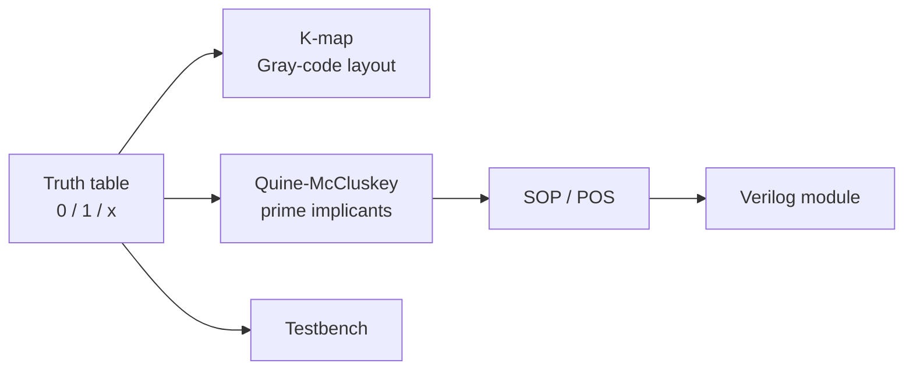

# K-Map Logic Minimization Tool

An interactive browser tool for the Digital Circuits course (EE1202, IIT Hyderabad). Enter a truth table for 1 to 5 variables and it produces the Karnaugh map, minimized Sum-of-Products and Product-of-Sums expressions, and a Verilog module with a matching testbench.

**[Try it live](https://rmuk655.github.io/K-Map-Logic-Minimization-Tool-/)**: no install, runs entirely in the browser.



## Features

- Truth-table entry for **1-5 variables**, each row set to `0`, `1` or `x` (don't care).
- **Karnaugh map** drawn from the table using Gray-code ordering.
- **Quine-McCluskey minimization**: prime implicants, essential-implicant selection and don't-care handling.
- **SOP and POS** output, both as readable Boolean algebra and as code-style expressions.
- **Verilog module** for the minimized function and a **testbench** that exercises the full truth table.
- **Download** of `module.v`, `testbench.v`, `minimized_SOP.txt`, `minimized_POS.txt` and the input table (`kmap_run.txt`).
- A simple logic-diagram preview of the expression.

## Run it locally

The live version above needs nothing. To run a local copy: the page loads React, Tailwind and Babel from CDNs, so it needs an internet connection and no build step. Serve the folder over HTTP (browsers often block loading `project.jsx` from `file://`):

```bash
cd "DC Project"
python3 -m http.server 8000
# open http://localhost:8000/index.html
```

## How to use it

1. Choose the number of variables (variables are named `A`, `B`, `C`, ...).
2. Set each minterm to `0`, `1` or `x`.
3. Click generate: the K-map, SOP, POS, Verilog and testbench appear.
4. Click *Download files* to save them, then simulate the module and testbench with any Verilog simulator such as Icarus Verilog to see waveforms.

```bash
iverilog -o sim module.v testbench.v && vvp sim
```

## Implementation

| File | Role |
|---|---|
| `DC Project/index.html` | Page shell; loads React 18, Tailwind and Babel standalone |
| `DC Project/project.jsx` | Quine-McCluskey solver, K-map layout, SOP/POS and Verilog generators, React UI |

The solver works on binary strings with `-` for eliminated variables: it repeatedly combines implicants that differ in one bit, collects the unmarked ones as prime implicants, then selects a cover. POS is obtained by minimizing the zeros of the function.

## Limitations

- Waveforms are not rendered in the page; run the generated testbench in a simulator.
- Minimal-cover selection is heuristic, so on some functions the result may be correct but not the smallest possible.
- Limited to 5 variables, as the problem statement requires.

## Original problem statement

> Create an interactive web simulator which takes truth tables for up to 5 variables and then generates a K-map. Using sum of products or product of sums, minimize the resulting function and display Verilog code for the expression obtained and the logic circuit diagram corresponding to the truth table. Verilog code, logical circuit diagrams, test bench and waveforms must be included.
